# TachoVision Pro


Applicazione web locale per analizzare le **carte tachigrafo digitali** (file `.DDD`).
Legge la carta direttamente da un **lettore USB smartcard** oppure dal file salvato.

Legge file `.DDD` di **prima e seconda generazione** (Gen1 / Gen2), controlla i tempi di
guida, lavoro e riposo secondo il **Reg. CE 561/2006** e la **Dir. 2002/15/CE**, pianifica
le ore residue ed esporta PDF ed Excel — tutto in locale, senza cloud, senza account,
senza abbonamento.

> ⚠️ **Versione Beta** — il software è funzionante ma potrebbero esserci bug.
> Per segnalazioni apri una [Issue](../../issues) su GitHub.

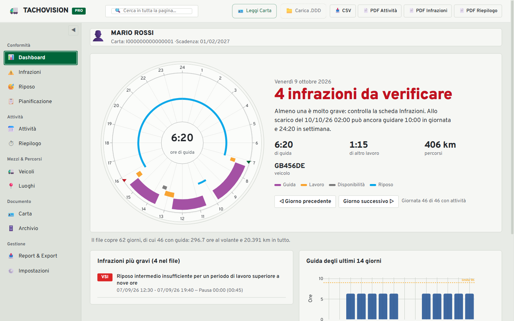

<sub>Tutte le immagini mostrano i **dati di esempio** inclusi nel programma (conducente
inventato MARIO ROSSI): nessun dato reale.</sub>

---

## Novità della versione 0.2.0

- **Nuovo aspetto "Carta disco"**: tema chiaro ispirato al disco del cronotachigrafo e alla
  segnaletica stradale; la Dashboard mostra la giornata su un **disco 24 ore**, con il
  verdetto in parole semplici e la guida ancora disponibile.
- **Motore delle infrazioni riscritto** su una linea del tempo continua: 33 tipi di
  infrazione, gravità **MI / SI / VSI / MSI** secondo il Reg. UE 2016/403, regole italiane
  (lavoro notturno, pause ogni 6 ore), filtri per periodo, gravità e tipo.
- **Storico del conducente**: gli scarichi precedenti della stessa persona in archivio
  vengono uniti per le infrazioni e la pianificazione, con avviso per i **dati mancanti** tra
  un file e l'altro e controllo dello **scarico entro 28 giorni**.
- **Nuove regole**: due riposi settimanali ridotti consecutivi all'estero (deroga dal
  20/08/2020) e uso scorretto del commutatore traghetto/treno.
- **Nuove schermate**: Periodi di riposo con compensazioni, Pianificazione (cosa si può
  ancora fare e "macchina del tempo"), Riepilogo del tempo di lavoro per giorno o turno,
  Paesi visitati, Utilizzo del veicolo, Impostazioni complete.
- **Dati inseriti a mano**: note, ferie e attività svolte senza carta, usate in tutti i calcoli.
- **Export rifatti**: PDF disegnati su pagina A4 (grafico 24 ore di ogni giorno, firme in
  fondo al rapporto infrazioni) ed Excel per attività, tempo di lavoro, veicoli, posizioni GPS
  e paesi.
- **Archivio**: backup e ripristino su file, zip per conducente, recupero dei file presenti
  nella cartella, nessuna copia doppia; promemoria dei 28 giorni e backup automatico settimanale.
- **Prova senza carta**: pulsante **"Prova con dati di esempio"** nella schermata iniziale.
- Correzioni del lettore `.DDD`: giorno dello scarico, tabella delle nazioni, tipo di luogo
  (inizio/fine), condizioni speciali (fuori ambito, traghetto/treno), sessioni dei veicoli.

### In arrivo

Lo sviluppo continua. Nelle prossime versioni:

- scelta automatica della combinazione di riposi più favorevole al conducente;
- nuove regole: spostamenti senza veicolo registrato, simbolo del paese al valico di
  frontiera, superamento consentito dall'Art. 12, guida notturna nei servizi bus;
- attività registrate con la carta nello slot del secondo conducente (equipaggio);
- infrazioni raggruppate per tipo, anche nel PDF, con scelta dei campi firma;
- informazioni carta più complete e controllo del lavoro continuo (max 6 ore) in Pianificazione;
- mappa GPS con navigazione punto per punto;
- tema scuro e altre lingue dell'interfaccia;
- lettura dei file scaricati dal **tachigrafo del veicolo** (velocità, superamenti, calibrazioni).

---

## Schermate

| | |
|---|---|
| 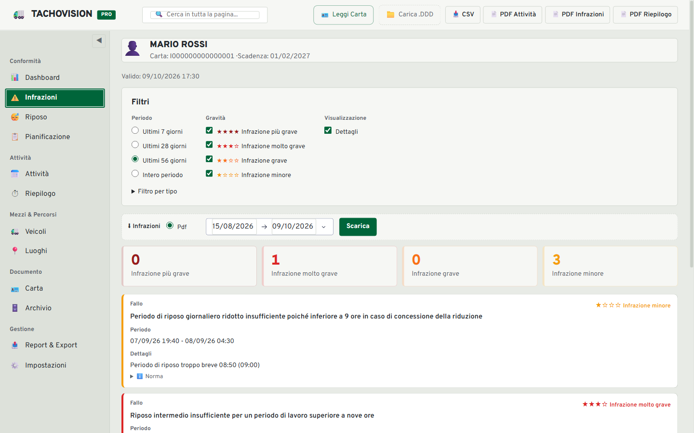 **Infrazioni** — gravità a stelle, periodo, dettagli e norma | 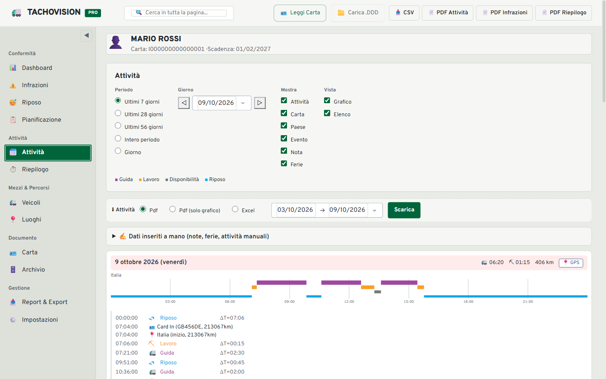 **Attività** — grafico del giorno, inserimenti carta, paesi |
| 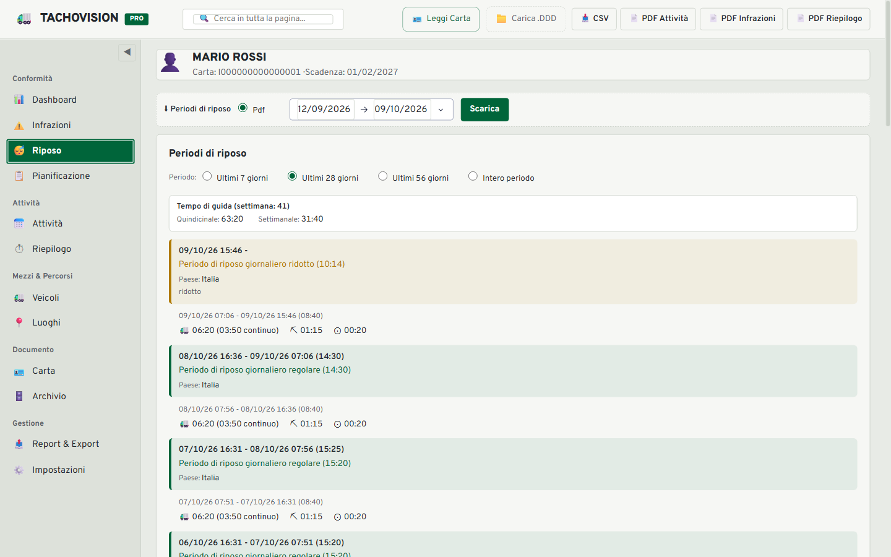 **Periodi di riposo** — giornalieri, settimanali, compensazioni | 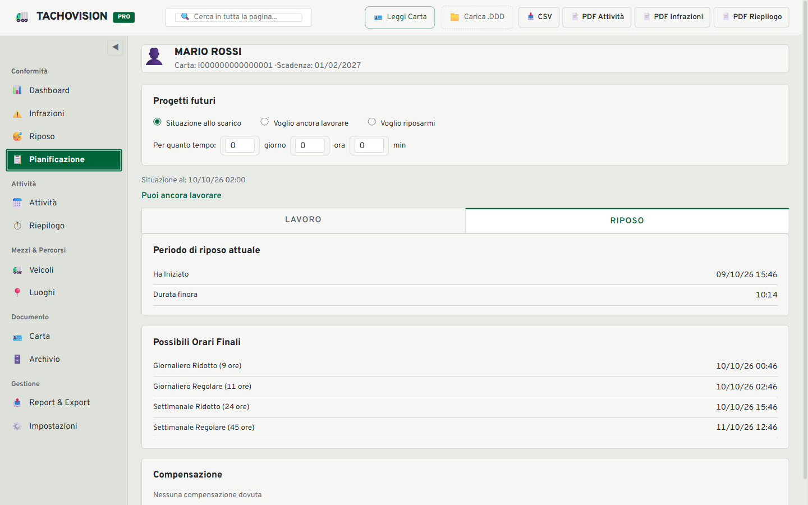 **Pianificazione** — prossimi riposi e ore residue |
| 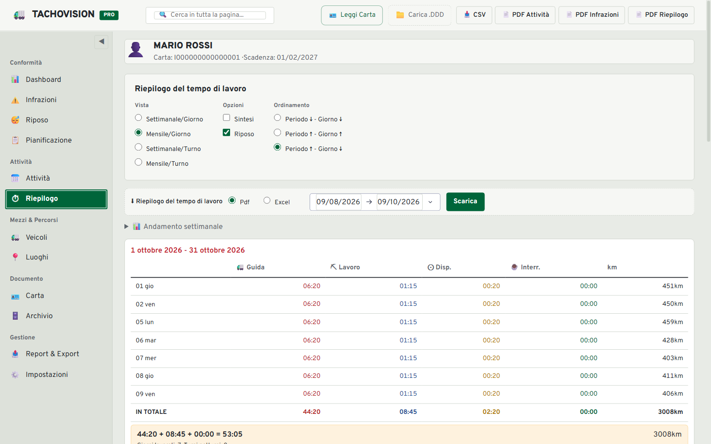 **Riepilogo del tempo di lavoro** — per giorno o turno | 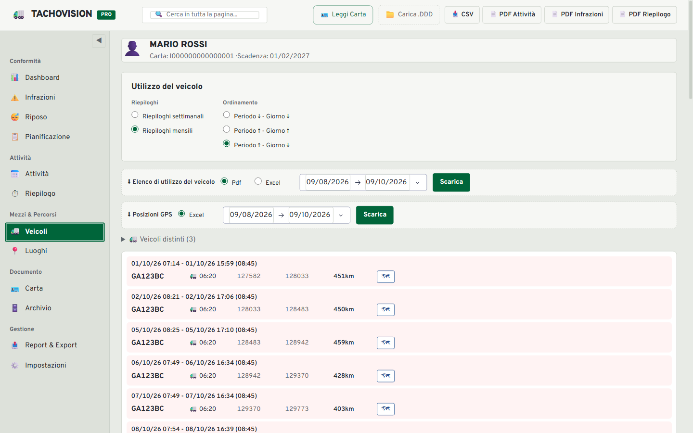 **Utilizzo del veicolo** — sessioni, km, posizioni GPS |
| 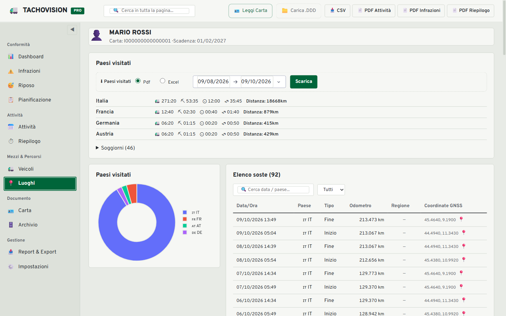 **Paesi visitati e luoghi** — ore per paese, coordinate | 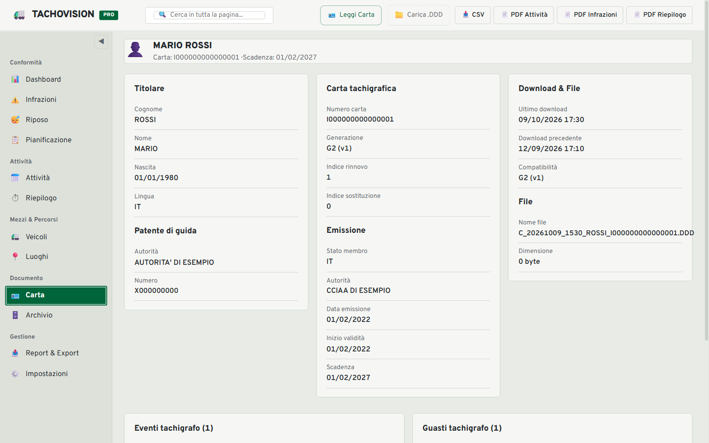 **Carta** — titolare, patente, emissione, scarichi |
| 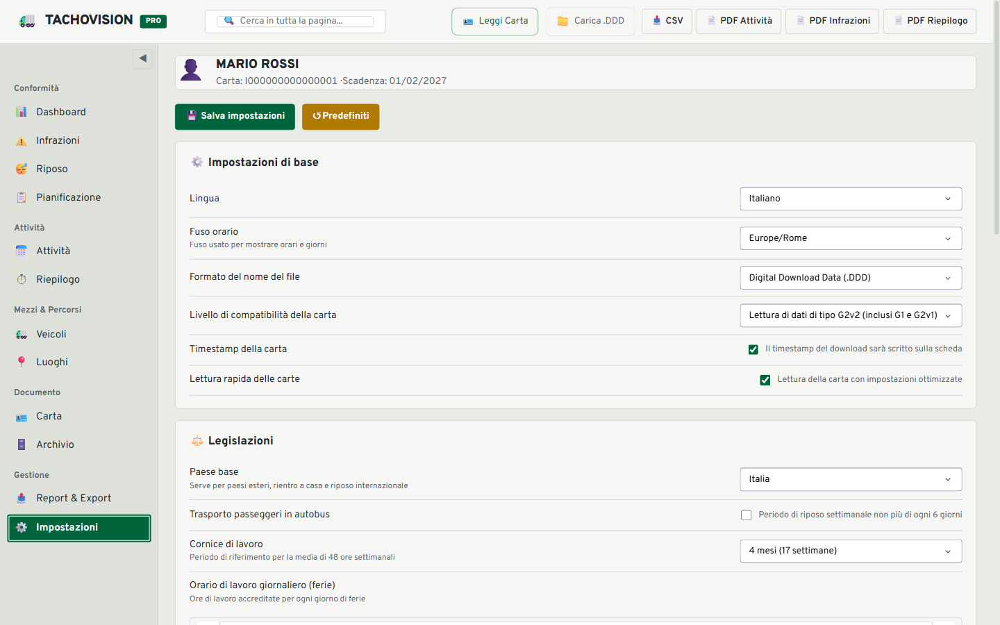 **Impostazioni** — legislazione, retribuzione, formati | 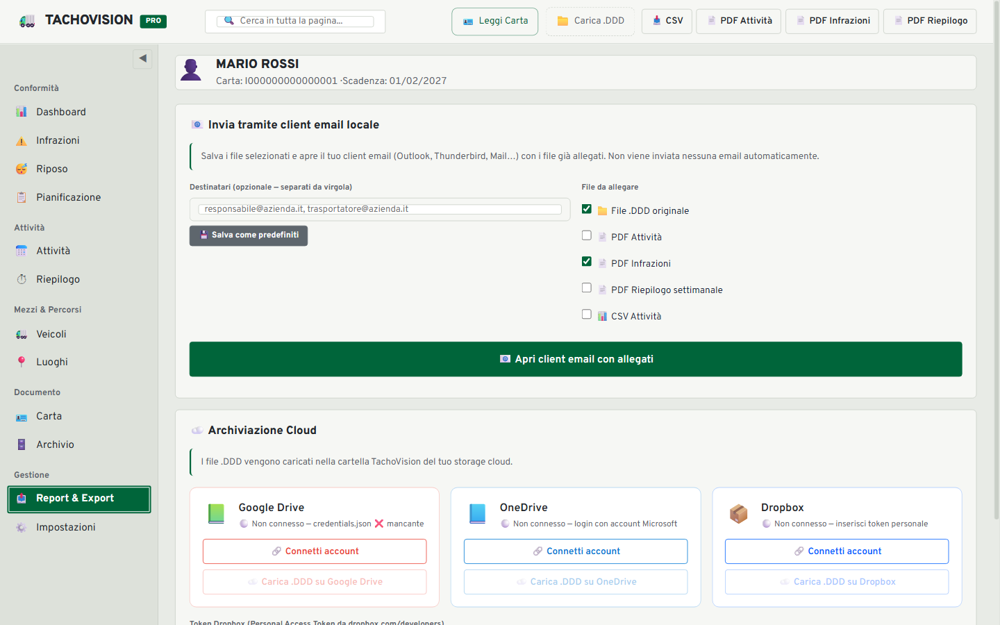 **Report & Export** — invio e archiviazione |

| PDF attività | PDF infrazioni | Telefono |
|---|---|---|
| 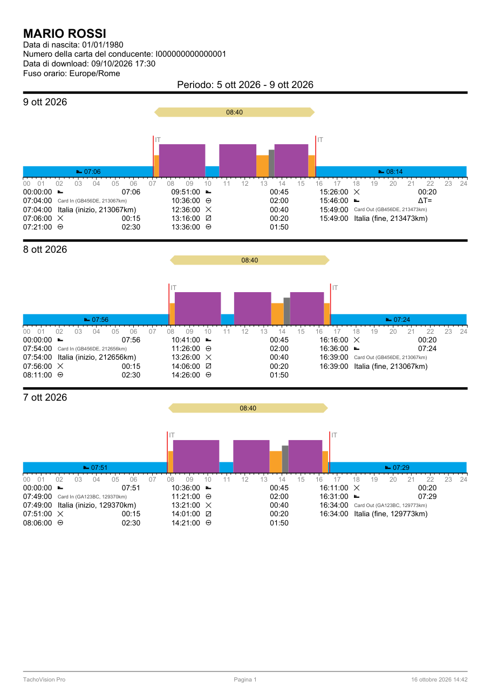 | 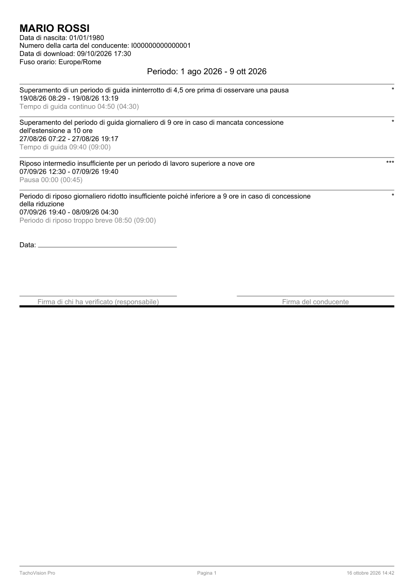 | 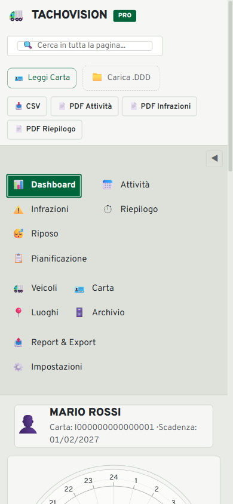 |

---

## Funzionalità

| Schermata | Cosa mostra |
|---|---|
| **Dashboard** | Disco 24 ore della giornata, verdetto sulle ultime 8 settimane, guida residua |
| **Infrazioni** | Violazioni Reg. CE 561/2006 e Dir. 2002/15/CE con gravità, periodo e dettagli |
| **Riposo** | Riposi giornalieri e settimanali, turni, guida settimanale e bisettimanale, compensazioni |
| **Pianificazione** | Situazione allo scarico, prossimi orari di fine riposo, simulazione di lavoro/riposo |
| **Attività** | Elenco e grafico per giorno, inserimento/estrazione carta, paesi, eventi, dati manuali |
| **Riepilogo** | Tempo di lavoro per giorno o turno, settimanale o mensile, pause retribuite, fascia oraria maggiorata |
| **Veicoli** | Sessioni di guida per veicolo con odometro, km, riepiloghi e mappa GPS |
| **Luoghi** | Paesi visitati con ore e distanze, registro luoghi con coordinate GNSS |
| **Carta** | Titolare, carta, patente, emissione, eventi e guasti registrati |
| **Archivio** | File `.DDD` salvati, promemoria 28 giorni, backup/ripristino, zip, storico conducente |
| **Report & Export** | Invio con il client e-mail, upload su Google Drive / OneDrive / Dropbox |
| **Impostazioni** | Lingua, fuso orario, paese base, legislazione, retribuzione, colori, formati |

**Export** (con periodo Dal/Al): PDF Attività (anche solo grafico), Riepilogo del tempo di
lavoro, Utilizzo del veicolo, Paesi visitati, Periodi di riposo, Infrazioni; Excel (CSV con
BOM, separatore a scelta) per attività, tempo di lavoro, veicoli, posizioni GPS e paesi.

**Formati supportati:**
- Gen1 (Reg. CE 1360/2002 / Reg. 3821/85)
- Gen2 V1 (Reg. UE 2016/799) — con dati GNSS
- Gen2 V2 — con buffer attività a coppia UTC/locale
- Estensioni `.DDD`, `.esm`, `.tgd`, `.C1B`

---

## Requisiti

- **Python 3.9+** (consigliato 3.10 – 3.13)
- **Windows** (testato su Win 10/11) — macOS e Linux supportati

---

## Installazione

### Windows — metodo rapido

Doppio clic su **`installa_windows.bat`** oppure, da PowerShell:

```powershell
.\installa_windows.ps1
```

Lo script installa automaticamente tutte le dipendenze Python.

### Manuale (Windows / macOS / Linux)

```bash
pip install -r requirements.txt
```

### Lettore smartcard USB (opzionale)

Per leggere la carta direttamente dal lettore fisico USB è necessario **pyscard**.

#### Python 3.10 – 3.13 (Windows, macOS) — installazione diretta ✅

pyscard distribuisce wheel pre-compilati su PyPI per Python 3.10, 3.11, 3.12 e 3.13.
**Nessun compilatore necessario**, basta:

```bash
pip install pyscard
```

#### Python 3.9 o 3.14+ su Windows — Build Tools richiesti ⚠️

Per Python 3.9 su Windows e per Python 3.14 o superiore (wheel non ancora disponibili),
è necessario installare prima i **Microsoft C++ Build Tools**:

1. Scarica da: [visualstudio.microsoft.com/visual-cpp-build-tools](https://visualstudio.microsoft.com/visual-cpp-build-tools/)
2. Installa il workload **"Sviluppo di applicazioni desktop con C++"**
3. Poi esegui:
   ```bash
   pip install pyscard
   ```

#### Linux — pacchetti di sistema richiesti

```bash
# Debian / Ubuntu
sudo apt-get install swig libpcsclite-dev
pip install pyscard

# Fedora / RHEL
sudo dnf install pcsc-lite-devel swig
pip install pyscard
```

> Senza pyscard l'applicazione funziona normalmente caricando file `.DDD` dal disco.
> Gli script di installazione Windows (`installa_windows.bat` / `.ps1`) gestiscono
> automaticamente entrambi i casi: provano prima il wheel, poi mostrano le istruzioni
> Build Tools solo se necessario.

---

## Avvio

```bash
python app.py
```

Apri il browser su: **http://localhost:8050**

Il programma è accessibile anche dagli altri dispositivi sulla stessa rete locale
(`http://<ip-del-pc>:8050`), anche da telefono.

### Avvio rapido su Windows

Doppio clic su **`start_app.bat`**

---

## Utilizzo

### Prova con i dati di esempio

Nella schermata iniziale clicca **"Prova con dati di esempio"**: vengono caricate 9 settimane
di attività inventate (conducente MARIO ROSSI) con veicoli, viaggio all'estero, posizioni GPS
e alcune infrazioni tipiche.

### Caricamento da file

1. Clicca **"Carica .DDD"** nella barra in alto (o trascina il file)
2. Seleziona il file `.DDD` della carta tachigrafo
3. I dati vengono caricati e visualizzati automaticamente

### Lettura da lettore USB

1. Inserisci la carta nel lettore USB collegato al PC
2. Clicca **"Leggi Carta"** (oppure attiva la lettura automatica nelle Impostazioni)
3. Attendi il completamento della lettura (10-30 secondi)

Il file viene salvato automaticamente nell'archivio locale.

### Navigazione

Usa la **barra laterale** a sinistra per passare tra le schermate.
La barra di ricerca in alto filtra il contenuto della schermata corrente.

### Archivio locale

La schermata **Archivio** conserva tutti i file `.DDD` letti o caricati, con backup e
ripristino su file. Un promemoria avvisa quando si avvicina la scadenza dei 28 giorni per
lo scarico della carta (obbligo di legge).

---

## Infrazioni rilevate

Implementate secondo **Reg. CE 561/2006**, **Reg. UE 165/2014** e **Dir. 2002/15/CE**,
con la gravità dell'Allegato I del **Reg. UE 2016/403**:

| Gruppo | Controlli |
|---|---|
| Tempo di guida | Guida continua > 4h30 (Art. 7), giornaliera > 9h / 10h (Art. 6§1), settimanale > 56h, bisettimanale > 90h, guida notturna bus |
| Riposo | Giornaliero regolare, ridotto, frazionato, in multipresenza (Art. 8); settimanale < 45h / < 24h, in ritardo, due ridotti all'estero non compensati, riposo regolare nel veicolo |
| Orario di lavoro | Settimanale > 48h / 60h, lavoro notturno > 10h, pause dopo 6h e 9h, lavoro continuo > 6h |
| Uso del tachigrafo | Simbolo del paese, inserimento manuale mancante, commutatore di fine giornata e traghetto/treno |
| Varie | Ispezione del veicolo prima della partenza, scarico della carta entro 28 giorni, dati mancanti tra due scarichi |

Le soglie e la modalità nazionale (es. regole italiane sul lavoro notturno) si regolano
nelle **Impostazioni**.

---

## Configurazione cloud (opzionale)

### Google Drive

1. Vai su [console.cloud.google.com](https://console.cloud.google.com)
2. Crea un progetto → Abilita **Google Drive API**
3. Credenziali → OAuth 2.0 → App desktop → Scarica JSON
4. Salva il file come: `~/TachoVision/config/gdrive_credentials.json`

### OneDrive

Richiede la registrazione di un'applicazione su [portal.azure.com](https://portal.azure.com):

1. Azure Active Directory → App registrations → New registration
2. Copia il **Client ID**
3. Imposta la variabile d'ambiente:
   ```bash
   # Windows
   set TACHOVISION_MSAL_CLIENT_ID=<il-tuo-client-id>

   # macOS / Linux
   export TACHOVISION_MSAL_CLIENT_ID=<il-tuo-client-id>
   ```

### Dropbox

Genera un **Personal Access Token** su [dropbox.com/developers/apps](https://www.dropbox.com/developers/apps)
e incollalo nella schermata Report & Export.

---

## Struttura del progetto

```
tachovision-pro/
├── app.py                      ← entry point: avvio server + layout
├── requirements.txt
├── installa_windows.bat / .ps1 ← installazione automatica Windows
├── start_app.bat               ← avvio rapido Windows
├── models/
│   ├── parser.py               ← lettore binario .DDD (Gen1 + Gen2)
│   ├── card_data.py            ← dataclass: CardData, Vehicle, Place…
│   ├── timeline.py             ← linea del tempo continua, riposi e turni
│   ├── violations.py           ← motore delle infrazioni
│   ├── history.py              ← storico unito degli scarichi del conducente
│   ├── rest_report.py          ← periodi di riposo e compensazioni
│   ├── planning.py             ← pianificazione e simulazione
│   ├── worktime.py             ← riepilogo del tempo di lavoro
│   ├── vehicle_report.py       ← utilizzo veicoli e paesi visitati
│   ├── day_events.py           ← righe giornaliere delle attività
│   ├── manual_data.py          ← note, ferie e attività inserite a mano
│   ├── settings.py             ← impostazioni
│   └── demo_data.py            ← dati di esempio inventati
├── views/
│   ├── theme.py                ← colori e caratteri del tema "Carta disco"
│   ├── charts.py               ← grafici (disco 24 ore, giornate, riepiloghi)
│   └── tabs/                   ← una schermata = un file Python
├── controllers/                ← callback Dash di ogni schermata
├── services/
│   ├── card_service.py         ← lettura smartcard USB (pyscard)
│   ├── report_service.py       ← export PDF ed Excel con periodo Dal/Al
│   ├── pdf_canvas.py           ← disegno dei PDF su pagina A4
│   ├── archive_service.py      ← archivio .DDD, backup, zip
│   ├── accessories.py          ← promemoria 28 giorni, backup settimanale
│   ├── email_service.py        ← apertura client email locale
│   └── cloud_service.py        ← Google Drive / OneDrive / Dropbox
├── tests/                      ← test automatici (pytest, solo dati inventati)
└── assets/
    ├── style.css               ← tema "Carta disco"
    ├── filter.js               ← ricerca globale
    └── sidebar.js              ← navigazione
```

---

## Privacy

I file `.DDD` contengono **dati personali sensibili** del conducente (identità, spostamenti, orari).

- Il programma gira **interamente in locale**: nessun dato viene trasmesso a server esterni
- I file vengono salvati solo nella cartella `~/TachoVision/archivio/` del PC
- L'upload cloud (Drive / OneDrive / Dropbox) avviene solo se configurato manualmente dall'utente
- Il trattamento dei dati tachigrafi è regolato dal **Reg. CE 561/2006** e dal **GDPR (Reg. UE 2016/679)**

---

## Dipendenze principali

| Libreria | Versione | Uso |
|---|---|---|
| [Dash](https://dash.plotly.com/) | ≥ 2.17 | Framework web reattivo |
| [Plotly](https://plotly.com/python/) | ≥ 5.22 | Grafici interattivi |
| [Dash Bootstrap Components](https://dash-bootstrap-components.opensource.faculty.ai/) | ≥ 1.6 | Layout e componenti UI |
| [pandas](https://pandas.pydata.org/) | ≥ 2.0 | Elaborazione dati tabellari |
| [ReportLab](https://www.reportlab.com/) | ≥ 4.0 | Generazione PDF |
| [pyscard](https://pyscard.sourceforge.io/) | opzionale | Lettura smartcard USB |

---

## Licenza

Distribuito per uso personale e professionale nel rispetto delle normative sul trattamento
dei dati tachigrafo (Reg. CE 561/2006, Dir. 2006/22/CE, Reg. UE 2016/679).

---

## Parole chiave

tachigrafo digitale · carta conducente · file DDD · lettore tachigrafo · analisi tachigrafo ·
digital tachograph · tachograph card reader · DDD file viewer · driver card analyzer ·
scarico carta tachigrafo · infrazioni tachigrafo · Reg. 561/2006 · orario conducenti ·
tempi guida e riposo · pianificazione riposi · tachograph analysis software · open source tachograph
